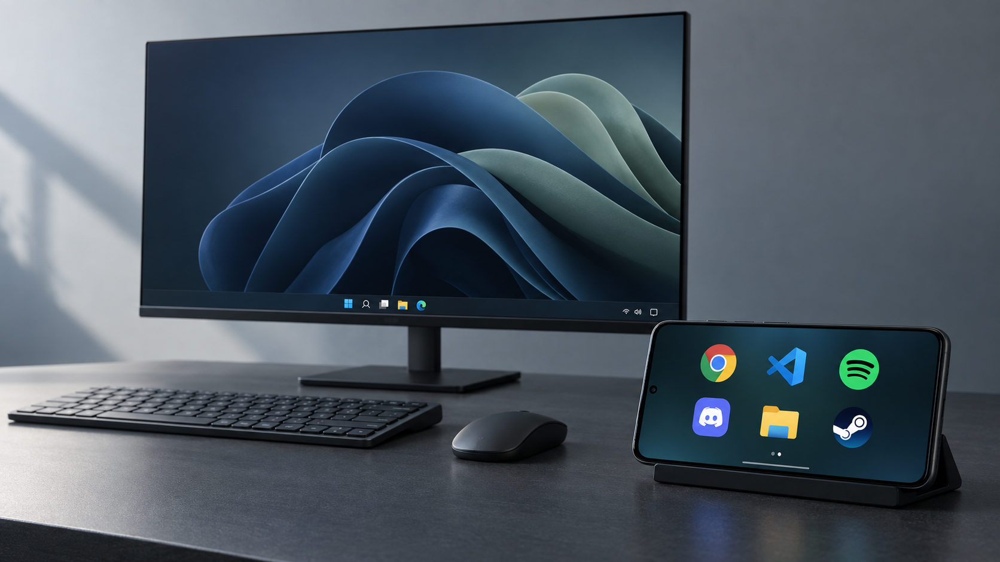

# WinDock

**Your Windows PC. Within reach.**

Turn an Android phone into a personal app dock for your Windows PC. Keep it
beside your keyboard, tap to launch apps, control your music, and capture your
screen — all over your local network, with no account or cloud service.

[Website & interactive demo](https://windock.vercel.app) ·
[Downloads](https://windock.vercel.app/#download) ·
[Releases](https://github.com/aliihsaad/WinDock/releases) ·
[Version history](CHANGELOG.md) ·
[MIT license](LICENSE)



*WinDock at your desk — an AI-generated product illustration.*

## Get started

| Platform | Availability |
| --- | --- |
| Windows 10 / 11, x64 | [Download the installer](https://github.com/aliihsaad/WinDock/releases/download/v0.2.2-preview.1/WinDockSetup.exe) |
| Android 7.0+ | [Download the APK](https://github.com/aliihsaad/WinDock/releases/download/v0.2.2-preview.1/WinDock-android-debug.apk) |
| iOS | Coming soon — [native companion development & GitHub builds](ios/README.md); no installable public release yet. |

1. **Install on your PC.** Open `WinDockSetup.exe`. It includes the required
   runtimes and adds WinDock to your Start menu and system tray.
2. **Install on your phone.** Open the Android APK and allow installation from
   your browser or file manager when prompted.
3. **Connect.** Keep both devices on the same trusted network. Open WinDock on
   your phone, select your PC, and enter the PIN from **Show connection info**
   in the Windows tray menu. Enter the tray address manually if discovery misses it.
4. **Make it yours.** Turn the phone sideways, swipe up, and open **Apps** to
   pin your favorites. Hold an icon to start arranging.

The Windows installer is currently unsigned and the Android APK is debug-signed.
Windows may show a publisher warning. An APK signed with a different key can
require uninstalling an earlier Android build before installing the new one.
See the [release notes and checksums](https://github.com/aliihsaad/WinDock/releases/tag/v0.2.2-preview.1).

**Updating:** quit WinDock from the Windows tray and run the latest installer;
your dock settings are kept. Reconnect the phone app to load the updated dock.
Update the Android app too. Previous public APKs use a different signing key:
uninstall the old Android app, install the new APK, and pair again. Phone-only
preferences reset on uninstall; your PC dock is preserved.
Starting with 0.2.1-preview.1, the Windows tray offers **Check for updates** and
checks at startup. A newer release shows a notification and download menu item;
installation remains manual. Older installations need one manual upgrade first.

For USB, connect a data-capable cable and enable **USB tethering** on Android.
Select **Connect by USB → Find USB PC**, then enter the normal tray PIN.
Choose **Connect by Wi-Fi** for wireless. Each mode remembers its own address;
reopening the app without a USB link returns to Wi-Fi. No USB debugging is needed.

Set idle dimming and screen rest under **This phone** on the connection screen
or **Appearance → This phone · screen & sleep** in the dock. Android’s screen
timeout may add a delay before the display turns off.

## What you can do

- **Launch your Windows apps.** Pin classic Start Menu shortcuts and packaged
  apps, including Claude and ChatGPT, with their real icons. Tap to launch or
  bring an app forward when Windows permits it.
- **Build your own dock.** Choose 4, 6, or 8 icons per page. Hold to rearrange,
  drag to an edge to move between pages, and swipe left or right to navigate.
- **Set the mood.** Choose a background and glass style. The landscape interface
  opens to large icons; swipe up for Apps, Controls, Capture, and Appearance.
- **Control the essentials.** Adjust volume and supported display brightness,
  control media playback, or use Windows power actions.
- **Capture your main monitor.** Save full-resolution PNG screenshots to
  `Pictures\WinDock`, or silent MP4 recordings to `Videos\WinDock`. Recordings
  fit within 1920×1080 at up to 15 fps and stop after 60 minutes. Stop from the
  phone or Windows tray. Audio and cursor overlays are not included.

Pinned apps and their order sync through the PC. Layout density, background,
and glass preferences stay on each device. The Windows tray also opens your
capture folders and offers optional startup with Windows during installation.

## Touchpad, keyboard and signatures

Swipe up and choose **Touch & sign**. The touchpad moves the PC cursor with one
finger, taps for left-click, and uses two fingers for scrolling or right-click.
The dark, edge-to-edge surface shows a soft glow under each finger. Back and
Signature sit at the bottom left, click/drag controls in the middle, and Speed
at the right. The controls stay visible; Speed opens a small slider above them.
Spread two fingers to zoom in or pinch them together to zoom out in PC apps
that support **Ctrl + mouse wheel**. Move the cursor over the image or document first.
The **Drag** button holds the left button until you release it. Leaving the
touchpad or losing the connection releases held buttons; Reconnect appears if
the session pauses or disconnects.

While using the touchpad in the updated Android app, clicking a supported PC text
field opens your phone's own keyboard, with emoji and its normal word composition.
Words appear on the PC when the keyboard commits them (usually at a space or a
suggestion). The keyboard button opens it manually for apps that don't expose text
focus. Existing PC text is not copied to the phone. Browsers have a manual keyboard
composer; automatic opening needs the updated Android APK.

Choose **Sign** beside the keyboard, or switch to **Signature**, and draw with a
finger or stylus. **Insert into PC** copies the image to the Windows clipboard and
requests a paste in the active app. The app must accept pasted images; plain text
fields cannot contain a signature image. **Save to PC** remains available.
Black or blue ink is exported as a transparent 1600×600 PNG in
`Pictures\WinDock\Signatures`. Open that folder from the Windows tray:
**Open saved files → Signatures**. Both saving and inserting keep a PNG here.
If an app cannot paste it, use that app's image insertion command with the saved
file. Undo and Clear stay on the phone.

These features are included in **0.2.0-preview.1**. Update both the Windows host
and Android app (version code 3). Direct drawing inside PC apps is deferred.
The PNG is a handwritten signature image, not a certificate-based digital signature.
Touchpad control follows Windows permissions and cannot operate secure prompts
or applications running with higher privileges than WinDock.

## How it works

The Windows companion serves the dock interface on your local network. The
Android app discovers the PC and displays that interface in a landscape
WebView. A Node.js host handles PIN pairing and live updates; a C# helper
performs the Windows actions. You can also open the tray address in a browser.

Your app actions and captures stay on your PC. WinDock is designed for a trusted
home or office network, not internet remote access. Sessions reset when the PC
host restarts. The website's interactive demo uses sample apps and simulated
touchpad, typing, signature and capture actions; it never connects to your PC.

## Current release

[0.2.2-preview.1](https://github.com/aliihsaad/WinDock/releases/tag/v0.2.2-preview.1)
adds USB tethering, clear Wi-Fi/USB connection choices, and phone-only idle dimming
and screen rest. The Android APK is version code 4. See the
[version history](CHANGELOG.md) for changes and upgrade notes.

The Windows installer and Android APK are built from this source.
[GitHub Actions](https://github.com/aliihsaad/WinDock/actions/workflows/build-release.yml)
checks Windows installation and Android builds. Published Android APKs use the
local preview signing key; disposable CI debug APKs may use a different key.

The initial [iPhone companion](ios/README.md) connects by PC address and reuses the
same dock and PIN pairing. A separate [macOS build workflow](https://github.com/aliihsaad/WinDock/actions/workflows/build-ios.yml)
builds it and runs simulator tests. Its unsigned device archive needs signing before
it can be installed on an iPhone; TestFlight and physical-device testing are pending.

Some behavior still depends on the PC and device:

- Windows can reject requests to bring an app to the foreground.
- Brightness requires a supported built-in panel or an external monitor with
  working DDC/CI support. Some picture modes and connections prevent changes.
- Running-app and media information may lag changes made directly on the PC.
- The exact physical-phone launch/focus acceptance gate remains unrecorded;
  see the [verification evidence](WINDOWS_READINESS.md) and [gates](GATES.md).
- Offline browser installation needs HTTPS or localhost; a plain LAN HTTP
  address serves the interface online but cannot register its service worker.

The native iOS companion is planned and is not available for download yet.
See the [roadmap](ROADMAP.md) for the remaining work and iOS plan.

## Develop locally

For the host, use **Node.js 20.11+**; CI uses Node.js 24. Windows builds also need
**.NET SDK 8**. Use **Inno Setup 7** for the installer. Android builds need
**JDK 17 or 21** and **Android SDK Platform / Build Tools 34**.

```powershell
npm ci
npm test
npm run build:windows
npm start
```

On Windows, `build:windows` prepares the helper used by `npm start` and creates
`artifacts\WinDock-win-x64\WinDockTray.exe`, which can run on its own. The host
prints its address and pairing PIN. A Linux provider is included for development;
Windows and Android are the downloadable app platforms.

| Command | Purpose |
| --- | --- |
| `npm test` | Run the 16 platform-independent verification scripts |
| `npm run build:windows` | Package the Windows helper, tray, Node host, and web UI |
| `npm run test:windows` | Run native Windows smoke checks |
| `npm run build:installer` | Create `artifacts/installer/WinDockSetup.exe` |
| `npm run test:installer` | Check installation, launch, upgrade, and uninstall in isolation |
| `npm run build:android` | Build, test, lint, and verify the Android APK |
| `npm run website` | Serve the website locally at `http://127.0.0.1:4173` |
| `npm run build:website-demo` | Regenerate the website demo from the actual app UI |

To serve locally built downloads, run `npm run package:downloads` after building
both installers. The website deploys to Vercel automatically from `main`; GitHub
Releases host the public download files.

More detail: [developer reference](docs/DEVELOPMENT.md) ·
[Android build and testing](android/README.md) ·
[website deployment](website/README.md).

## Contributing

[Open an issue](https://github.com/aliihsaad/WinDock/issues) with your Windows
version, phone model, reproduction steps, and expected behavior. For changes,
keep the platform-provider boundary intact and run `npm test`; native or Android
changes also need the relevant platform checks. Never include pairing PINs,
session cookies, or your personal dock configuration in a report or commit.

## License

WinDock's source code is available under the [MIT license](LICENSE).
Copyright © 2026 [Ali Saad](https://github.com/aliihsaad).
Third-party dependencies and app icons retain their own licenses and trademarks.
